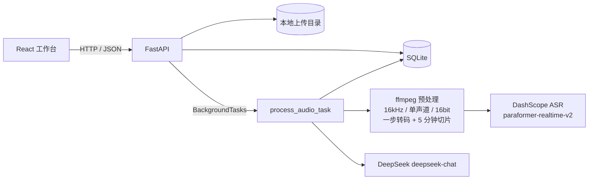
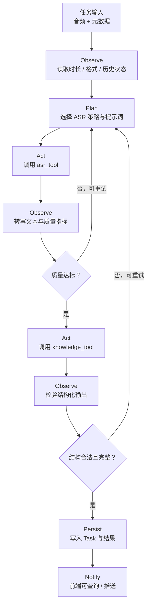

# 架构设计说明

本文档记录课堂录音智能整理 Agent 的架构选型、关键取舍，以及未来基于 DSH（DeepSeek Harness）升级为智能体调度的规划。

## 1. 背景与目标

系统需要完成一条完整业务链路：

```text
音频上传 → 语音识别（ASR）→ 知识框架生成（LLM）→ 结果持久化 → 前端展示 → 历史回看
```

设计目标：

- 前后端职责清晰，便于独立开发与迭代；
- 处理链路可替换：ASR、LLM、存储都可以单独升级；
- 先以保证课程演示的稳定性为主，同时为后续智能体化预留空间；
- 所有密钥只保存在服务端，前端不接触第三方 API Key。

## 2. 总体架构

系统由浏览器端、FastAPI 服务、SQLite、本地文件存储，以及两个外部 AI 服务组成。完整图示见 [docs/system-architecture.md](./docs/system-architecture.md)。



## 3. 为什么选择前后端分离

### 3.1 主要理由

1. **职责边界清晰**
   前端只负责交互、轮询与展示；后端负责校验、存储、第三方调用与任务状态，避免 API Key、文件系统和数据库逻辑泄漏到浏览器。
2. **独立开发与迭代**
   UI 调整不影响后端接口；后端替换 ASR 模型或 LLM 时，前端无需重新构建。
3. **技术栈匹配**
   React + Vite 适合快速构建交互式工作台；Python 生态更适合 AI SDK、文件处理与后续 Agent 编排。
4. **可部署性**
   前端可独立构建为静态资源并托管到 CDN；后端可以独立扩容、限流与做鉴权。
5. **可测试性**
   接口契约稳定后，前后端可以各自做单元测试与 Mock；后端可用 `TestClient` 直接验证 API。

### 3.2 代价与应对

| 代价 | 应对方式 |
|---|---|
| 需要处理 CORS | 后端维护明确的 `CORS_ORIGINS` 白名单 |
| 需要同时启动两个服务 | README 提供 PowerShell 一键式启动步骤 |
| 接口契约需要同步 | 使用 FastAPI 自动生成的 OpenAPI 文档作为契约 |
| 多一次网络往返 | 上传与轮询接口均为轻量 JSON，实际影响可忽略 |

没有选择“单体全栈框架”（如 Next.js API Routes + 前端同仓）的原因是：AI 处理侧依赖 Python SDK、长任务与未来 Agent 运行时，放在 Python 服务中更自然。

## 4. 为什么选择 FastAPI

### 4.1 技术原因

1. **原生异步支持**
   ASGI + `async` 路由适合处理上传、轮询等 I/O 密集请求；第三方调用放在后台任务中，不阻塞响应。
2. **Pydantic 数据校验**
   请求体、路径参数、查询参数都有类型校验与自动错误响应，减少手写校验代码。
3. **自动 OpenAPI 文档**
   启动即生成 `/docs` 与 `/openapi.json`，前后端联调成本低。
4. **依赖注入**
   `Depends(get_db)` 统一管理数据库会话，保证请求结束后正确关闭连接。
5. **内建 BackgroundTasks**
   当前阶段无需引入消息队列即可异步执行处理逻辑，适合 MVP。
6. **可测试性**
   `fastapi.testclient.TestClient` 可在无真实网络依赖时验证路由与数据库逻辑。
7. **生态完整**
   SQLAlchemy、python-multipart、OpenAI SDK、DashScope SDK 均可平滑集成。

### 4.2 与其他方案对比

| 方案 | 优势 | 未采用原因 |
|---|---|---|
| Flask | 轻量、生态成熟 | 异步与类型校验能力较弱，OpenAPI 需额外配置 |
| Django | 全家桶、ORM 与管理后台完善 | 对当前轻量 API 场景偏重，启动与结构成本更高 |
| Express / NestJS | 前后端同语言 | ASR/LLM 的 Python SDK 与 Agent 生态更成熟 |
| Serverless 函数 | 弹性好 | 长任务、文件存储与本地开发调试更复杂 |

## 5. 当前实现的关键取舍

### 5.1 SQLite + 本地文件系统

- SQLite 零配置、便于课程演示与本地复现；
- 音频文件保存在 `backend/app/uploads`，数据库只存相对路径；
- 局限：不适合多实例并发写入与大规模文件存储。

**升级路径**：数据库切换 PostgreSQL；文件迁移到 OSS/S3；数据库只保存对象 Key。

### 5.2 BackgroundTasks + 前端轮询

- 上传接口立即返回 `task_id`，处理在后台线程中执行；
- 前端每 2 秒查询一次任务状态，终结后停止轮询；
- 优点：实现简单、无额外中间件；
- 局限：服务重启会中断任务，缺少重试、死信与可观测性。

**升级路径**：替换为 Celery / RQ / DSH Worker，配合任务队列、重试策略与超时控制。

### 5.3 ASR 模型与音频管道

当前采用「统一格式 + 分段识别 + 多文件合并」的后端音频管道：

1. **多文件接收**：`POST /api/upload` 接收 `files` 列表，按上传顺序保存，一条 Task 记录通过 `filepaths` 保存全部路径；
2. **转码与切片**：用 `subprocess` 调用 `backend/bin/ffmpeg.exe`，一条命令同时完成转码 **16kHz / 单声道 / 16bit** 与 **5 分钟切片**；
3. **长音频切片**：按固定 **5 分钟** 切分为 `chunk_000.wav`、`chunk_001.wav` 等，存放在以 `classroom_task_{id}_` 为前缀的临时目录中；
4. **分段 ASR**：逐段调用 `paraformer-realtime-v2` 的 `recognize_file`，`format` 固定为 `wav`，`sample_rate` 固定为 `16000`；
5. **容错合并**：单个切片或单个音频失败时记录日志并跳过；按文件顺序拼接所有有效文本为 `final_transcribed_text`；全部为空才判失败；
6. **一次性生成**：合并后的完整文本一次性交给 DeepSeek，生成一份覆盖整节课的复习笔记；
7. **清理**：临时目录通过 `TemporaryDirectory` 自动清理，不污染上传目录。

采用该管道的原因：

- 原始音频的采样率、声道数、容器格式不统一，直接传给实时 ASR 容易失败；
- 短音频实时接口处理超长录音时可能无法返回有效文本，切片可降低单段失败风险并隔离错误；
- 一节课常被拆成多个录音，合并处理可避免用户多次提交并得到割裂的笔记；
- 统一成 16k 单声道 16bit 是 ASR 最稳定的输入形态，也避免采样率校验问题。

**ffmpeg 依赖**：不再使用 pydub，也不需要 ffprobe。代码按 `backend/bin/ffmpeg.exe` → `backend/app/bin/ffmpeg.exe` → PATH 的顺序查找 ffmpeg；缺失时返回带目标路径的明确错误，任务状态为 `failed`。

**升级路径**：长录音可切换到 `qwen3-asr-flash-filetrans` 或 `paraformer-v2` 异步文件转写，配合 OSS、任务队列与切片并行识别。

### 5.4 异常处理策略

- 上传层：格式、大小、文件写入、数据库提交均有明确错误码与清理逻辑；
- 处理层：ASR、LLM、数据库写入分阶段捕获，失败统一写入 `failed + result`；
- API 层：全局捕获数据库异常与未处理异常，返回结构化 JSON，避免暴露堆栈；
- 前端：ErrorBoundary 兜底渲染异常，所有请求均有 loading / error 分支，避免白屏。

### 5.5 PPT 上下文与动态学科

- 用户在前端填写 `subject`，后端写入 `Task.subject`，Prompt 中的角色、输出类型与术语保留要求均由该值动态生成，不硬编码任何具体学科。
- 可选择上传 `.pptx`：`python-pptx` 提取每页文本框、表格与备注文字，存入 `Task.ppt_context`。
- 由于流程是“先 PPT 后音频”，`POST /api/upload_ppt` 会创建一条占位 `Task` 并返回 `task_id`；音频上传携带该 `task_id` 时复用同一条记录，未携带时新建任务（音频-only 场景）。
- Prompt 采用简单 RAG 注入方式，把 `{subject}`、`{ppt_context}` 与完整 `transcribed_text` 一起提供给 DeepSeek，并要求模型结合 PPT 推断“这里/这个函数”等指代。
- PPT 只提取文字，不解析图片；超长 PPT 文本会直接进入上下文，后续可按页切片并做检索式注入。

### 5.6 对话助手与直播讲解

- 左侧 40% 为智能助手聊天区，右侧 60% 为上传、状态、动态板书画布与历史工作区。
- 前端不再要求填写课程名称：后端在转写完成后调用 DeepSeek，根据 PPT 大纲（优先）或转写文本自动推断科目，并写回 `Task.subject`，供笔记与分镜 Prompt 使用。
- `POST /api/chat` 由后端调用 DeepSeek，接收 `message`、`subject` 与可选 `note_context`；当前笔记会作为上下文注入，避免把 API Key 暴露给浏览器。
- 长音频切片后使用 `ThreadPoolExecutor` 并发调用 ASR，默认并发 4（`ASR_MAX_WORKERS`），在吞吐与 DashScope 限流之间取平衡；结果按切片原始顺序合并，单段失败仍可跳过。
- 任务进度写入 `Task.progress`（0-100）与 `Task.status_message`：转码切片、逐段识别、科目识别、笔记生成、讲稿编排各阶段都会更新，前端轮询后渲染真实进度条，避免长音频干等。
- 分镜脚本采用「启发式步步为营」结构：每个 segment 包含 `board_content`、开场白 `speech_text`，以及 `step_by_step` 数组（每步含 `board_highlight`、`highlight_lines`、`speech_text`），强制老师先出题、再一步步推导，不允许直接罗列答案。
- 每个 segment 还包含 `quiz`（question / 4 options / correct_answer / explanation_correct / explanation_wrong / explanation_guess），分镜最后一步讲完后前端弹出随堂小测：答对可选「我真懂了」或「我是蒙的」，答错直接进入耐心讲解；解析由 TTS 播报后再进入下一分镜。
- 点击「开始上课」后，在首段 TTS 音频返回前，画板区展示随机轮换的准备旁白（例如「李老师正在翻教案、调麦克风…」）与呼吸灯提示，音频真正开始播放后自动隐藏。
- 前端直播状态机：`idle → playing → waiting → (playing | explaining | interrupting → listening → thinking → resuming) → paused → ended`。每讲完一步进入 `waiting`，等待学生确认。
- 互动控制面板提供「听懂了，下一步」「没听懂，再讲讲」和双向语速开关：默认「老师讲慢点」切到 0.8x 后按钮变为「讲快点吧老师」，再点恢复 1.0x；快捷键为 `Enter` / `→`、`R`。切换后会用新语速重播当前步骤，保证立刻生效。
- 举手打断是全局常驻能力和右下角悬浮按钮：点击后立即停止直播与左侧聊天的所有 TTS，由 `/api/teacher_cue` 现场生成一句问候（每次不同，例如「哟，手举这么高，是不是前面哪儿绕晕了？」）并开启麦克风；无语音输入或麦克风不可用时自动显示文字输入框。
- 所有 DeepSeek 请求共享 `app/services/persona.py` 中的「李老师」人设：大学金牌讲师，耐心鼓励、幽默爱打比方、允许语气词，并明确要求开场白每次不同、禁止「这个问题问得不错」这类套话；资料生成类请求使用保留人设但允许结构化输出的 `TEACHER_AUTHOR`。
- `/api/ask_teacher` 先做意图识别，返回 `intent`（`pause` / `slow_down` / `speed_up` / `question`）与现场生成的 `answer`：`pause` 会幽默地让学生快去快回并原地等待；`slow_down` / `speed_up` 会答应调整节奏；`question` 会先判断问题类型——基础概念或理解偏差用「这里可能有个小误区」温和纠正，只有真正有深度的问题才肯定「这个问题很有深度」，随后给出结论或类比；`question` 回答后再由 `/api/teacher_cue` 生成一句「要继续刚才的内容吗？」的变体。对话类 temperature 统一在 0.85~1.15，保证开场白多样。
- 分镜 Prompt 强制每个分镜的第一句是自然过渡且句式互不重复，明确禁止「先别急着记结论」「先看这张结构图」这类模板句；前端不插入任何讲解首句，lecture 的第一句话完全来自后端返回的 `storyboard[].speech_text`。
- 随堂小测反馈不再使用分镜里预生成的固定解释：前端把题目、选项、正确答案、学生选择与 `kind` 发给 `/api/quiz_feedback`，由大模型现场生成夸张表扬、情绪安慰或幽默调侃；只有调用失败时才回退到分镜里的兜底文案。
- 前端只保留必要的状态旁白（准备、思考、聆听、结束等），统一放在 `frontend/src/lib/teacherLines.ts` 的文案库里随机轮换，不再出现固定的「老师正在思考」式机械提示；所有对话内容均由大模型生成。
- 左侧聊天回答在文字返回后自动调用 `/api/tts` 播报，气泡内显示小喇叭与「老师正在语音解答…」；若直播正在播放，会先暂停直播并记录恢复点，避免两个声音重叠。
- 语速不使用 `audio.playbackRate`（会失真、有电音）：前端把 `speed`（0.5~2.0）传给 `/api/tts`，后端通过 CosyVoice 原生 `speech_rate` 参数合成，从下一句开始生效。
- 「没听懂」时调用 `POST /api/explain_again`，把当前板书与步骤讲稿交给 DeepSeek，要求用更通俗的类比重新解释；播报完成后仍停留在当前步骤等待再次确认。
- 语音合成固定使用 DashScope CosyVoice `cosyvoice-v3-flash` / `longanhuan_v3`，代码不再读取其他音色、也不回退到 v2；`POST /api/tts` 接收文本后先经 `clean_text_for_tts()` 剔除 LaTeX、代码块、Markdown 标记与纯符号行，再合成 16kHz 单声道 WAV 并修正流式 WAV 头后返回音频流。清洗后为空时前端跳过 TTS、仅显示文字。
- 分镜 Prompt 明确禁止大标题、章节名、课程总结与「整理自课堂录音」这类说明性文字，并要求跳过原文本中的标题，只从正文知识点开始；后端 `_is_meaningful_speech()` 会再过滤纯标题/纯符号片段，避免空白分镜。前端使用 react-markdown + remark-gfm + remark-math + rehype-katex 渲染正文、聊天与板书，GFM 表格会显示为 HTML 表格。
- 「上传参考音频」入口已预留，仅记录文件，不发送后端，为后续 CosyVoice 音色克隆做准备。
- 「生成讲解视频」按钮为预留位，代码注释标明后续可接入 Seedance 类视频生成接口，因延迟原因暂不启用。

## 6. DSH Agent Loop 升级规划

### 6.1 什么是 DSH

DSH（DeepSeek Harness）可以理解为一层围绕大模型的 **Agent 运行框架（Harness）**：负责工具注册与调用、上下文与记忆管理、任务规划、循环控制、状态持久化与可观测性。具体 SDK 与部署方式以官方文档为准。

当前链路是**固定编排**：

```text
ASR → 清洗 → LLM → 入库
```

DSH 的价值是把这条固定链路升级为**可规划、可验证、可重试的 Agent Loop**。

### 6.2 为什么需要 Agent Loop

固定链路在以下场景会失效或效果不佳：

- 音频过长，需要切片、并行转写与结果合并；
- 音频质量差，ASR 结果需要置信度评估与二次识别；
- 不同学科需要不同的知识框架模板；
- 模型偶发超时、限流或输出格式不符合预期；
- 需要根据成本和延迟动态选择模型。

Agent Loop 可以：

1. 观察输入（时长、格式、大小、语言）；
2. 规划处理策略（直接转写 / 切片 / 换模型）；
3. 调用工具并观察结果；
4. 对转写与知识框架做质量校验；
5. 未达标则重试或降级；
6. 达标后持久化并通知。

### 6.3 工具抽象

| 工具 | 职责 |
|---|---|
| `asr_tool` | 调用 ASR，支持短音频与长音频文件转写 |
| `audio_tool` | 读取时长、采样率，必要时切片或转码 |
| `transcript_qa_tool` | 校验转写质量、语言、空文本与异常片段 |
| `knowledge_tool` | 调用 DeepSeek 生成结构化知识框架 |
| `schema_validator` | 校验 Markdown / JSON 输出是否满足约定结构 |
| `storage_tool` | 持久化结果、附件与中间产物 |
| `notify_tool` | 完成后通知前端或消息渠道 |

### 6.4 Agent Loop 结构



### 6.5 循环终止条件

为避免无限循环与成本失控，必须定义明确终止条件：

- 输出通过 Schema 校验且质量分数达到阈值；
- 达到最大迭代次数（如 3 次）；
- 达到时间预算（如单任务 10 分钟）；
- 达到成本预算（按 Token / 调用次数）；
- 需要人工介入时转入 `needs_review` 状态。

### 6.6 分阶段迁移

| 阶段 | 目标 | 关键动作 |
|---|---|---|
| Phase 1 | 工具化 | 将 ASR、LLM、文件、数据库操作封装为可复用工具接口，行为保持不变 |
| Phase 2 | 影子运行 | DSH 与现有固定链路并行执行，对比结果与成本，不影响线上 |
| Phase 3 | 切换调度 | 后端只负责提交任务，DSH Worker 负责 Agent Loop 与状态回写 |
| Phase 4 | 评估与治理 | 增加质量评估、Trace、成本看板、失败样本回流 |

迁移过程中保持现有 API 契约不变，前端无需感知内部编排变化。任务状态可在内部扩展为 `planning / transcribing / generating / retrying / needs_review`，对外仍映射为 `pending / completed / failed`。

### 6.7 风险与应对

| 风险 | 应对 |
|---|---|
| Agent 行为不确定 | 结构化输出 + Schema 校验 + 最大迭代限制 |
| 成本与延迟上升 | 模型分级、缓存、预算控制、并行切片 |
| 重复处理 | 幂等键（task_id + 尝试次数）、状态机约束 |
| 数据隐私 | Key 仅服务端、最小化日志、可配置保留周期 |
| 故障恢复 | 任务队列、指数退避重试、死信队列 |
| 可观测性不足 | 统一 Trace ID、记录每轮工具调用与耗时 |
| 供应商锁定 | ASR / LLM 抽象为 Provider 接口，可切换实现 |

## 7. 结论

当前架构以“简单、可运行、可演示”为第一优先级：前后端分离保证边界清晰，FastAPI 提供轻量且类型安全的 API 层，SQLite 与本地文件系统降低部署成本，固定 ASR → LLM 链路保证结果稳定。

随着音频规模、质量要求和业务复杂度提升，可用 DSH 将固定链路演进为 Agent Loop：先工具化，再影子运行，最后切换调度，在不破坏现有接口的前提下获得更强的规划、重试与评估能力。
