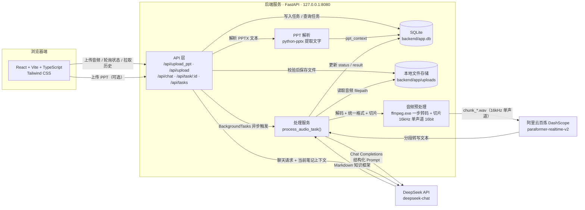

# 系统架构图

本文档描述课堂录音智能整理 Agent 的整体架构与数据流转关系。

## 架构总览

## 组件职责

| 组件 | 职责 | 关键实现 |
|---|---|---|
| 前端工作台 | 左右分栏、展示状态、渲染笔记、历史回看、互动朗读 | `frontend/src/App.tsx` |
| 对话服务 | 将当前笔记作为上下文调用 DeepSeek 回答用户问题 | `backend/app/services/chat_service.py` |
| API 层 | 参数校验、文件落盘、任务读写、触发后台处理 | `backend/app/api/routes/` |
| PPT 解析 | python-pptx 提取文本框、表格、备注文字 | `backend/app/services/ppt_parser.py` |
| 后台处理服务 | 调度预处理、ASR 与 DeepSeek，汇总结果并回写状态 | `backend/app/services/audio_processing.py` |
| 音频预处理 | subprocess 调用 ffmpeg，一步完成转码与 5 分钟切片 | `_split_with_ffmpeg` / `_run_ffmpeg` |
| SQLite | 持久化任务元数据、状态与结果 | `backend/app/models/task.py` |
| 本地文件存储 | 保存上传的音频原始文件 | `backend/app/uploads/` |
| DashScope ASR | 对每个切片进行语音识别 | `paraformer-realtime-v2` |
| DeepSeek | 将口语文本提炼为知识框架 | `deepseek-chat` |

## 关键数据流

1. 用户填写课程名称，选择或拖入音频文件，可选选择 `.pptx` 课件。
2. 若上传 PPT：前端调用 `POST /api/upload_ppt`，后端用 python-pptx 提取文字并创建占位 `Task`，返回 `task_id`。
3. 前端以 `multipart/form-data` 调用 `POST /api/upload`，重复 append 多个 `files`，并带上 `subject` 与可选 `task_id`。
4. 后端逐个校验扩展名与大小，使用时间戳 + 序号重命名并保存到 `app/uploads`。
5. 后端写入/更新一条 `Task` 记录，保存 `filepaths`、`subject`、`ppt_context`，初始状态 `pending`，立即返回 `task_id`。
6. 后端通过 `BackgroundTasks` 异步执行 `process_audio_task(task_id)`。
7. 处理服务依次读取每个音频的绝对路径，用 subprocess 调用 ffmpeg，一步完成转码与切片。
8. ffmpeg 输出 16kHz / 单声道 / 16bit 的 `chunk_000.wav`、`chunk_001.wav` 等临时切片。
9. 逐段调用 DashScope ASR；单个切片或单个音频失败时记录日志并跳过，按文件顺序拼接有效文本得到 `final_transcribed_text`。
10. 读取 `Task.subject` 与 `Task.ppt_context`，动态拼接 Prompt，调用 DeepSeek 生成学科复习笔记。
11. 更新数据库：成功写入 `completed + result`，全部为空或异常写入 `failed + 错误信息`。
12. 前端每 2 秒轮询 `GET /api/task/{task_id}`，任务终结后停止轮询并展示结果。
13. 前端通过 `GET /api/tasks` 获取历史任务列表，点击后拉取对应任务详情。
14. 左侧聊天发送消息时调用 `POST /api/chat`，后端把 `subject` 与当前笔记作为上下文交给 DeepSeek。
15. 右侧直播画布按分镜播放 CosyVoice 音频（`POST /api/tts`），同步切换并高亮 Mermaid / 代码 / 大字要点；点击「举手打断」或按空格暂停音频，进入语音问答流程，回答播报后重播被打断的分镜。

## 部署与边界

- 前端与后端独立运行：前端 Vite 5173，后端 Uvicorn 8080。
- 跨域访问受 `CORS_ORIGINS` 白名单限制，默认允许 `localhost:5173` 与 `127.0.0.1:5173`。
- API Key 仅保存在后端 `.env`，不会下发到浏览器。
- 当前为单机部署模型：SQLite + 本地文件系统 + 进程内后台任务。

## 后续扩展方向

- 将 `BackgroundTasks` 替换为独立任务队列（如 Celery / RQ / DSH Worker），支持重试与任务恢复。
- 将音频存储迁移至对象存储（OSS/S3），支持长音频的异步文件转写。
- 引入 DSH Agent Loop，将固定的 ASR → LLM 流程升级为可规划、可重试、可评估的智能体调度，详见 [DESIGN.md](../DESIGN.md)。
