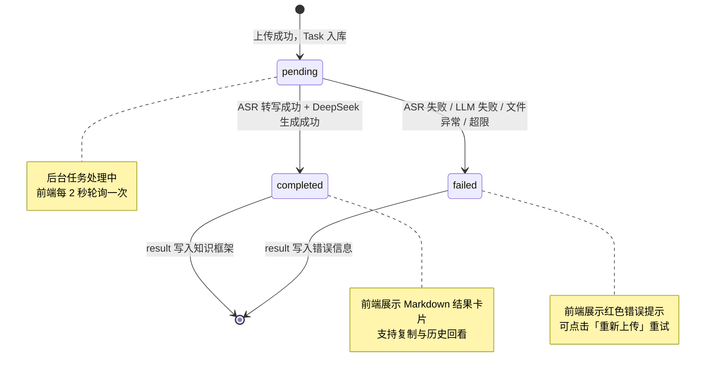

# 任务状态流转图

任务状态持久化在 SQLite 的 `tasks.status` 字段，当前共有三种终态/中间态：`pending`、`completed`、`failed`。

## 状态机

## 状态说明

| 状态 | 含义 | 是否终态 | `result` 内容 |
|---|---|---|---|
| `pending` | 文件已保存、任务已入库，等待或正在后台处理 | 否 | `null` |
| `completed` | ASR 与 DeepSeek 均成功 | 是 | Markdown 知识框架 |
| `failed` | 任一处理环节失败 | 是 | `处理失败：<具体错误>` |

## 流转触发条件

### `[*] → pending`

- 用户填写课程名称 `subject`；可选上传 `.pptx` 创建占位任务并返回 `task_id`；
- 一次可提交一个或多个音频，扩展名为 `mp3 / wav / m4a`；
- 每个文件大小不超过 1.5GB（可通过后端环境变量 `MAX_UPLOAD_SIZE_MB` 调整）；
- 文件逐个成功写入 `backend/app/uploads`；
- 只创建一条 `Task` 记录，`filepaths` 中保存全部路径；
- 接口立即返回 `{"task_id": ..., "status": "pending", "file_count": N}`。

### `pending → completed`

- 每个音频经 ffmpeg 成功转码为 16kHz / 单声道 / 16bit WAV 并完成切片（失败的文件跳过）；
- 长音频切片后逐段调用 `paraformer-realtime-v2`，单个切片失败也跳过；
- 至少一个音频返回有效转写文本，所有有效文本按文件顺序合并；
- DeepSeek `deepseek-chat` 对合并文本返回非空 Markdown 内容；
- 结果与状态成功提交到数据库。

### `pending → failed`

任一条件成立即进入失败态：

- 未配置 `DASHSCOPE_API_KEY`；
- 找不到 ffmpeg.exe，且所有音频都无法转码切片；
- 所有音频均未识别出有效文本（含全部切片失败或全部为静音）；
- 未配置 `DEEPSEEK_API_KEY`；
- DeepSeek 超时、报错或返回空内容；
- 结果写库失败（记录日志，任务保持原状态）。

> 单个音频或单个切片失败不会中断任务，只会记录日志并跳过；这保证部分成功的音频仍能生成笔记。

## 设计说明

- 数据库中不单独设置 `processing` 状态：上传成功到处理结束之间均保持 `pending`，前端通过本地 `processing` 视图表达“正在处理中”。
- 终态一经写入不再自动变更，保证前端轮询逻辑简单、幂等。
- 失败原因统一写入 `result`，前端无需额外的错误字段即可展示。
- 服务重启可能中断后台任务，使记录停留在 `pending`；后续接入任务队列后可增加超时重置与重试机制。

## 对应实现

- 状态定义：`backend/app/models/task.py`
- 状态写入：`backend/app/api/routes/upload.py`、`backend/app/services/audio_processing.py`
- 状态查询：`backend/app/api/routes/task.py`
- 前端轮询：`frontend/src/App.tsx` 中的 `useEffect` 与 2 秒 `setInterval`
